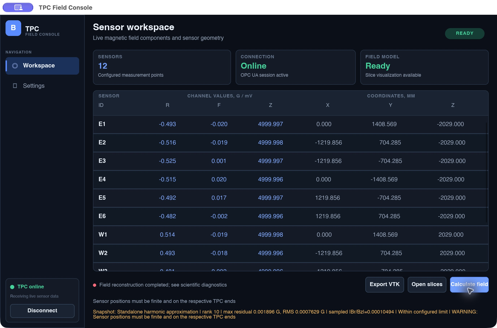
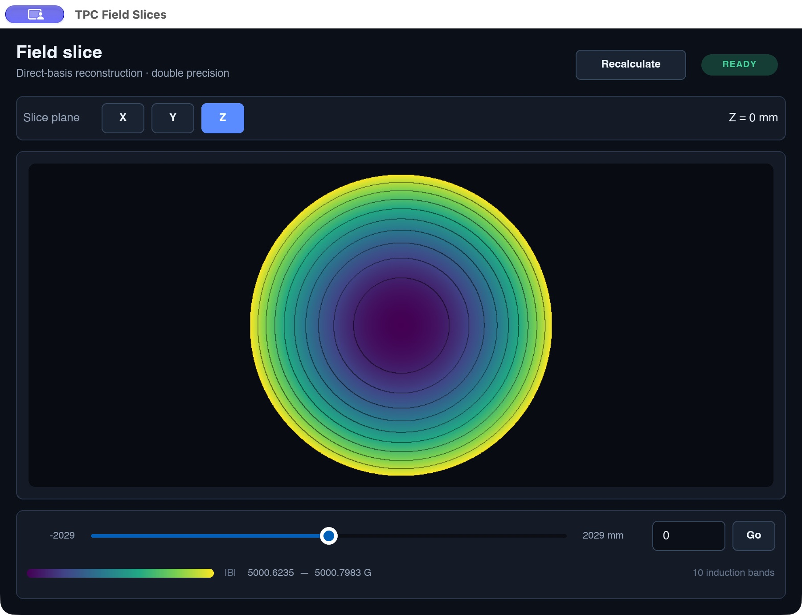
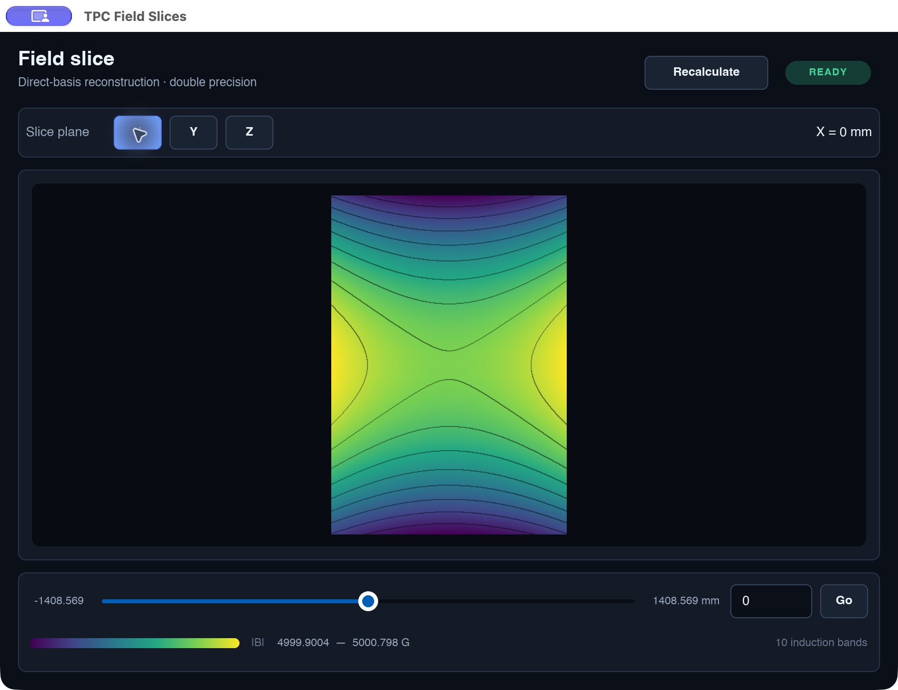

# Восстановление магнитного поля в объёме TPC

## 1 Исходные данные и метод

**Исходные данные.** 12 трёхкомпонентных датчиков E1…E6 и W1…W6 дают 36 значений Br, Bφ и Bz. Радиус области — 1408,569 мм, длина — 4058 мм. Датчики расположены на торцах z = ±2029 мм. Номинальное поле — 5000 Гс, или 0,5 Тл. Координаты задаются в миллиметрах, поле — в гауссах.

Напряжения датчиков преобразуются по индивидуальным коэффициентам: B = k(V − V₀), где V и V₀ — в мВ, k — в Гс/мВ. Данные поступают через OPC UA.

**Физическая модель.** В области без токов и при постоянной магнитной проницаемости поле удовлетворяет условиям

$$
\nabla\cdot\mathbf B=0,\qquad \nabla\times\mathbf B=0.
$$

Используется сумма десяти гармонических векторных мод: однородное продольное поле, осесимметричные изменения и поперечные составляющие. Каждая мода удовлетворяет указанным условиям.

$$
\mathbf B(r,\varphi,z)=\sum_{k=0}^{9}c_k\mathbf f_k(r/L,\varphi,z/L),
\qquad L=\max_i\{|r_i|,|z_i|\}.
$$

**Определение коэффициентов.** Значения мод в точках датчиков образуют матрицу A размером 36 × 10. Вектор b содержит измеренные компоненты. Коэффициенты выбираются так, чтобы сумма квадратов расхождений была минимальной:

$$
\widehat{\mathbf c}=\arg\min_{\mathbf c}\|A\mathbf c-\mathbf b\|_2^2.
$$

Система решается методом сингулярного разложения SVD в библиотеке Eigen. Перед решением нормируются координаты и столбцы матрицы. Для определения численного ранга используется относительный порог 10⁻¹⁰. Полный ранг выбранной модели равен 10.

При наличии опорной карты метод применяется к разности между текущими измерениями и значениями карты. Итоговое поле равно

$$
\mathbf B=\mathbf B_0+\Delta\mathbf B_{harm}.
$$

Опорная карта интерполируется по восьми вершинам ячейки; выход за её границы запрещён. Без карты рассчитывается самостоятельная гармоническая модель. Результат доступен в виде объёмной сетки, срезов X, Y, Z и файла VTK.

**Контроль качества.** Вычисляются ранг, обусловленность, максимальная и RMS невязки. Порог максимальной невязки — 0,2 Гс. В узлах объёма проверяется max |Br/Bz| ≤ 5,2·10⁻⁴; при |Bz| < 1 Гс отношение считается неопределённым. Невязка характеризует согласованность модели с датчиками и не доказывает абсолютную точность карты.

## 2 Результаты проверки

Научные тесты выполнены в Release на macOS arm64 с Clang 23.1.3. **Все 87 проверочных условий прошли:** восстановление гармонических мод, сохранение ранга при масштабировании, проверки div/curl, коррекция опорной карты, обработка некорректных данных, срезы и экспорт.

Дополнительный эксперимент выполнен на известном десятимодовом поле. Датчики размещены при r = 4 мм, z = ±3,5 мм, по шесть на окружности. В 36 каналов добавлялось возмущение δbⱼ = ε sin(1,7j). Восстановление сравнивалось с точным полем в 3349 контрольных узлах.

| Амплитуда ε Гс | Максимальная невязка Гс | Максимальная ошибка в объёме Гс |
|---|---|---|
| 0 | 1,82·10⁻¹² | 2,73·10⁻¹² |
| 0,05 | 0,068504 | 0,028609 |
| 0,10 | 0,137008 | 0,057218 |
| 0,20 | 0,274016 | 0,114436 |

Во всех случаях ранг равен 10, обусловленность нормированной матрицы — 1,34863. При ε = 0,20 Гс строгий режим отклоняет расчёт из-за невязки выше 0,2 Гс; строка получена в режиме предупреждений.

На снимке: ранг 10, max невязки 0,001896 Гс, RMS 0,0007629 Гс, max |Br/Bz| = 1,0494·10⁻⁴. Значение ниже порога 5,2·10⁻⁴, но выше 10⁻⁴. Предупреждение о координатах датчиков сохранено; расчёт выполнен в предварительном режиме на сетке 32 × 32 × 32, без опорной карты.

## 3 Срезы восстановленного поля

Срезы относятся к расчётному снимку на рисунке 1. Цвет показывает модуль поля |B|; шкала отдельно нормируется для каждого среза. Данные синтетические, не являются измерениями магнита MPD.

**Результат работы.** Реализованы восстановление трёх компонент поля, коррекция опорной карты, диагностика, срезы и экспорт. Численная реализация проверена на тестовых полях. Точность на реальной установке требует независимых контрольных измерений.
